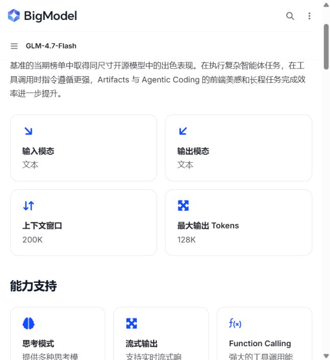
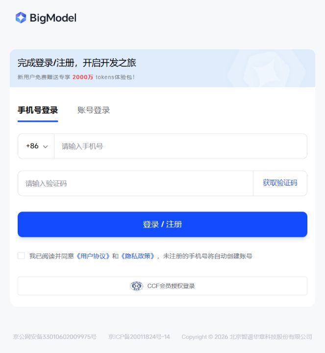
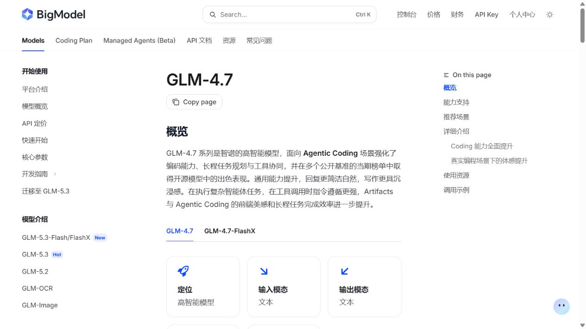

# 郭昱祺：两个模型产品的体验与改进分析

负责人：郭昱祺（102400413）。资料核对：2026-11-09（北京时间）。仓库基线：`e8c97e422f2c4c23cea4802e81f8fdf36dcab53c`。

## 1. 体验对象、方法与完成范围

本组当前模型为智谱 BigModel 上的 `glm-4.7-flash` 和 `glm-4.7`，不是早期接入记录中的 DeepSeek。两者是同一平台上的两个不同模型，平台导航和登录交互有共性，不能将共同界面差异写成模型能力差异。网页端用于体验，API 记录用于核验实际生成结果；网页模型名称不能自动证明与 API 使用相同参数。

本报告包含本次实际查看的官方功能页和体验入口、对已有 Flash 冒烟结果的复核，以及同维度的对照体验方案。**截至核对时，网页体验中心停留在未登录状态；GLM-4.7 没有成功对话记录；没有真实学生采访材料。因此本报告是有证据边界的阶段性交付，尚不能替代双产品完整使用及采访验收。** 用户已确认先准备采访材料，执行方案见[采访包](guo-yuqi-interview-kit.md)。

为便于核验，本文使用以下证据编号：

| 编号 | 类型 | 内容 |
| --- | --- | --- |
| E01 | 本次页面观察 | [Flash 官方页面](https://docs.bigmodel.cn/cn/guide/models/free/glm-4.7-flash)与[截图](../evidence/guo-yuqi/glm-4.7-flash-official-2026-11-09.jpg) |
| E02 | 本次页面观察 | 点击 Flash 的“体验中心”后跳转登录页，[截图](../evidence/guo-yuqi/bigmodel-trial-login-2026-11-09.jpg) |
| E03 | 已有 API 记录复核 | [2026-11-07 Flash 成功冒烟](../evidence/zhipu-glm-4.7-flash-smoke-success-2026-11-07.json)，非本次新增调用，非正式实验 |
| E04 | 仓库配置事实 | [模型配置](../configs/models.json)：Flash 启用，GLM-4.7 禁用；[提示词](../prompts/system_v1.md)要求最多一个关键追问 |
| E05 | 本次页面观察 | [GLM-4.7 官方页面](https://docs.bigmodel.cn/cn/guide/models/text/glm-4.7)与[截图](../evidence/guo-yuqi/glm-4.7-official-2026-11-09.jpg) |
| E06 | 实验输入事实 | [三个场景和五款教学模拟车](../configs/evaluation-v1.json)、[参考集合](../data/reference-answers-v1.json) |

## 2. 模型一：GLM-4.7-Flash

### 2.1 基本功能与使用路径

官方页面列出文本输入/输出、200K 上下文、128K 最大输出，以及思考模式、流式输出、Function Calling、上下文缓存、结构化输出和 MCP 等能力（E01）。这些是厂商公布的接口能力，不代表本项目已实现全部功能。项目当前以统一 JSON 输出接入，不使用联网或工具调用，`max_tokens=4096`，关闭思考和流式输出（E04）。200K/128K 是页面上限，不能当作本次实际输入输出量。

本次操作路径为“官方模型页 → 使用资源 → 体验中心 → 登录/注册页”。登录页支持手机号及账号登录，当时另出现安全验证；未继续注册、填写个人资料或生成对话（E02）。因此可以确认入口和登录要求，无法评价登录后会话列表、参数控件或编辑体验。

### 2.2 购车结果的实际证据

已有冒烟使用的是[三车冒烟库](../examples/smoke_case.json)，条件为不超过20万元、城市通勤、纯电或插电混动、L2、至少5座。**该库不同于正式场景的 SIM-A 至 SIM-E，不能混用价格和编号。** E03 中 `models[0]` 可核对到：

- 请求与回显 ID 均为 `glm-4.7-flash`；`valid=true`、`finish_reason=stop`，纠正次数0。
- `parsed_output.candidate_cars` 返回轿车A（18.8万元，`smoke-car-001`）及SUV B（17.6万元，`smoke-car-002`）。两车都满足该冒烟输入的硬约束，型号、配置、年份和价格可回查。
- `effective_constraints` 列出预算、用途、能源、辅助驾驶和座位；`status=candidate_only`，最终推荐为空。因此这条记录只能证明一次候选输出，不能证明四轮决策已完成。
- `next_question` 原文为：“您更倾向于纯电车型（A）还是插电混动车型（B）？或者您对车辆的续航里程有特殊要求吗？”同一字符串包含两个问题，与“最多一个问题”的要求不符。Schema 通过没有发现这一语义问题。
- `total_latency_ms=89282`，即89.282秒；`total_usage.total_tokens=2456`，其中输入1773、输出683。这是一次非流式请求的日志值，不是首字延迟、均值或四轮耗时。接入说明中的16.8秒来自另一条短请求描述，不与这条完整冒烟混算。

### 2.3 优缺点、准确度与改进

| 维度 | 已观察的优点 | 局限及对应改进 |
| --- | --- | --- |
| 数据 | 两个候选的编号和关键字段可回查固定库（E03） | 仅三车冒烟，不能代表真实市场覆盖；在结果上展示模拟属性、配置、年份和来源日期 |
| 界面 | 官方页面集中提供能力与体验入口（E01） | 本次必须登录才能继续（E02）；登录后可用性待实际操作记录 |
| 功能 | 结构化列出候选、约束、理由和风险（E03） | 单轮没有参数比较及最终推荐证据；完整四轮后再评价任务闭环 |
| 准确度 | 样本中的候选满足给定硬约束（E03） | 两个追问仍通过Schema；增加语义检查，未知参数不能补造 |
| 等待体验 | 日志保留耗时与token便于复核（E03） | 89.282秒提示长等待风险，但无现场用户等待反应；加入进行状态、取消和有界重试，并实测用户是否误判卡顿 |

上述改进是**作者建议**。尚不能把“用户想要来源卡片”或“用户无法接受等待”写成真实采访结论。

## 3. 模型二：GLM-4.7

### 3.1 基本功能与页面体验

本次从官方“模型概览 → 全部模型 → GLM-4.7”进入详情页。页面提供 GLM-4.7/GLM-4.7-FlashX 两个标签，默认选中 GLM-4.7；**FlashX 与本组的免费 Flash 是不同标识，截图和后续运行必须区分。** 官方列出文本输入/输出、200K上下文、128K最大输出，以及与Flash类似的思考、流式、工具调用、缓存和结构化输出入口（E05）。其“高智能、长程规划和工具协同”属于官方定位，不能直接转为购车评测结论。

### 3.2 同维度分析

| 维度 | 可确认内容 | 仍需实际体验的内容 |
| --- | --- | --- |
| 数据 | 计划使用与Flash相同的E06固定库 | 是否引用正确编号、是否补造参数 |
| 界面 | 官方页区分GLM-4.7与FlashX，提供功能和调用示例 | 登录后是否可选精确模型、切换是否清空会话 |
| 功能 | 官方公布结构化输出及工具协同等入口 | 候选、需求变更、参数比较和最终推荐能否完整完成 |
| 准确度 | 配置中保留`glm-4.7`这一对照候选 | 当前没有成功响应，准确度和指令遵循不可评分 |
| 成本与等待 | 项目默认禁用，需先核对实际额度和价格 | 单次及完整任务耗时、token、费用、失败和纠正次数 |

**可讨论的优势和风险。** 同平台同参数接入有利于减少适配差异；官方公布的能力使它适合作为复杂取舍任务的对照候选。是否优于Flash、是否更慢或更贵，都需要在相同条件下实际验证。默认禁用是配置状态，不是模型失败，不纳入成功率分母。

**作者改进建议。** 对两模型共用的体验界面展示精确模型ID、是否开启思考/联网、新会话入口及结果来源；切换模型时明确本轮是否沿用上下文。购车结果都经过相同的硬约束与来源检查。该建议针对可比较性和核验成本，不是假设已发现界面缺陷。

## 4. 可执行的统一体验与补证办法

登录后的完整体验按[采访包中的四轮脚本](guo-yuqi-interview-kit.md)执行，每个模型新开会话，提供相同五车数据，记录实际模型标签、日期、可见参数和联网状态。网页端无法关闭某项功能时记录差异，其主观体验不合入API质量分数。

至少保存每模型“初选、变更后、参数表、最终推荐”的真实截图和文字。无结果、验证码、额度不足、超时均按实际状态记录，不用官方截图或历史输出替代。专业学生的采访另存原话、观察时间线、图片及同意范围；记录表未填时，不能从计划中生成满意度或偏好票数。

## 5. 由证据引出的产品方向

E03表明结构合规与内容合规需要分别核验；E06提供了可复核的需求变更任务。这支持优先规划“约束变更可见、参数可回查、未知值留空、单次澄清明确”的购车助手。真实用户是否需要这些功能、两个模型是否能满足要求，分别由采访与正式实验检验。完整NABCD、优先级和验收指标见[产品规划](guo-yuqi-product-plan.md)。

## 参考与原始材料

官方页面访问日均为2026-11-09，页面文本、截图及哈希见[证据索引](../evidence/guo-yuqi/README.md)。本次核对的[作业原文](https://bbs.csdn.net/topics/620578230)要求两个产品体验、10–30分钟真实专业学生使用及图文采访，并明确区分观察与原因推测。[接入说明](model-access-and-configuration.md)和[评测协议](evaluation-protocol-v1.md)用于理解仓库运行边界。真实采访和第二模型对话仍待补齐。
